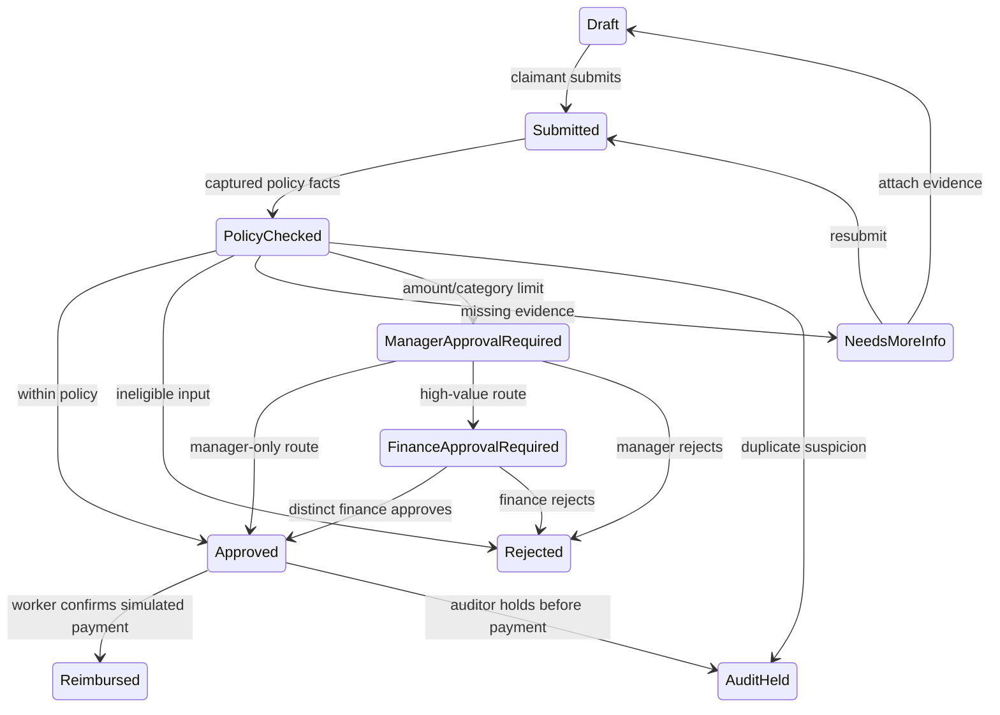

# Explicit transitions

Auditors may also hold other non-draft, non-reimbursed, non-held states. Held,
rejected and reimbursed claims have no ordinary resubmission/release command.
Audit investigation/recovery is deliberately outside this first version.
Draft and NeedsMoreInfo also support a revision command. Revision clears the
current receipt and assessment and returns Draft; historic snapshots and
authorized receipt downloads remain available. File integrity is checked by
the shell before progression/payment. Audit-chain failure blocks mutations.
Reimbursement is a Finance-queued outbox operation, not a public Reimburse
domain-command endpoint. The worker rechecks Approved under the ledger lock.

All ten state variants appear in the exhaustive `StateNames.Of` and persistence
mapping switches. A controlled missing case must fail compilation. Business
transitions use explicit allowed-state patterns; a complete 10-state approval
and reimbursement matrix is exercised by tests.
